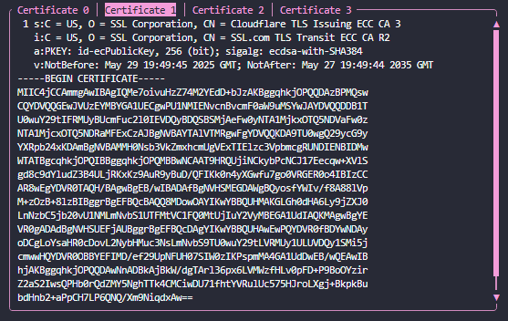

# tls-certificate-cli

Inspect the TLS certificate chain of any website.

## Usage

Pass in the website you want to check as a command line argument `cargo run -- www.github.com`.

If you want to use the tool anywhere in console `cargo install --path .` in this project root. After that you can use `cert-inspect github.com`.

Press q to quit the program. Navigate with arrow keys.

## Requirements

Linux