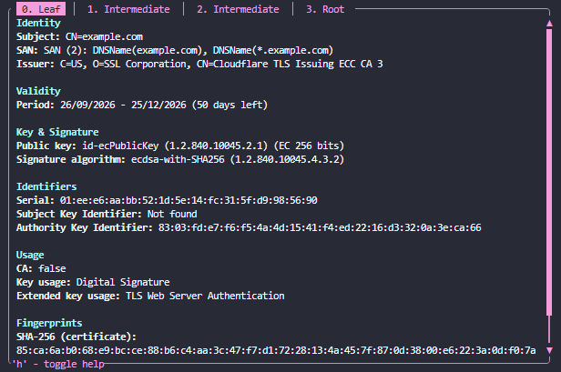

# tls-certificate-cli

Inspect the TLS certificate chain of any website. Fetches TLS certificates of a websites server with rustls, they are then parsed with the help of x509-parser. Works on Linux, macOS and Windows.

## Usage

Pass in the website you want to check as a command line argument `cargo run -- www.github.com`.

If you want to use the tool anywhere in console, run `cargo install --path .` in this project root. After that you can use `cert-inspect github.com`.

Press q to quit the program. Navigate with arrow keys.

## Features

Lists this information about certificates:

- Identity
  - Subject
  - SAN
  - Issuer
- Validity
  - Period and how many days left
- Key & Signature
  - Public key
  - Signature algorithm
- Identifiers
  - Serial
  - Subject Key Identifier
  - Authority Key Identifier
- Usage
  - CA
  - Key usage
  - Extended key usage
- Fingerprints
  - certificate SHA-256
  - SPKI pin
